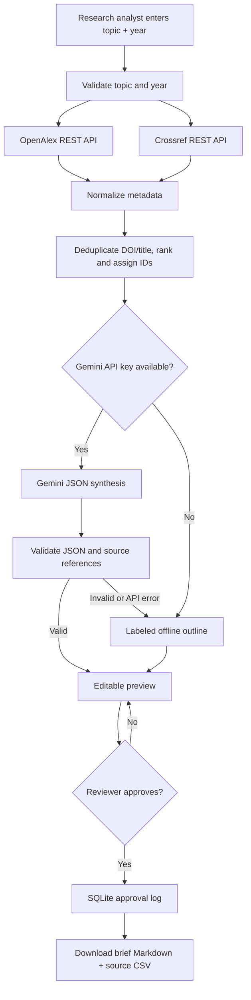

# Architecture and decisions

## End-to-end flow



## Data contracts

**Input:** `{topic: str(4–120 chars), since_year: int(2000–current), gemini_api_key: optional secret}`.

**Paper** after normalization:
`{title, year?, authors[], doi?, url?, abstract?, citations, sources[]}`. DOI is canonical lowercase without `doi.org` URL prefix.

**Ranked source record:** Paper plus `id: S1...S10`; citations in AI output are validated against the ID set. All remote strings are treated as untrusted input and truncated.

**AI response:**

```json
{
  "summary": "short reading-queue overview",
  "themes": [
    {"heading": "candidate theme", "note": "what to inspect, not unverified conclusions", "source_ids": ["S1"]}
  ],
  "actions": ["open and verify full text"],
  "limitations": "abstracts and metadata are incomplete"
}
```

Missing sections, invalid formats or nonexistent source identifiers are rejected, triggering a clearly labeled offline fallback. The fallback is **not marketed as AI output**.

**Persisted approval:** UTC timestamp, topic, generation mode, source record count, edited flag, full approved Markdown, source-status summary; API credentials never persisted.

## Human vs AI boundaries
- **Machine:** retrieve, normalize, deduplicate, format citations, propose a research plan.
- **AI (if configured):** synthesize a cautious, sourced *reading plan* using retrieved abstracts/metadata, without claims of reading full papers.
- **Human:** verify source links, read relevant abstracts/papers, correct errors, decide whether to use the brief, click approval.

## Major tradeoffs
- Two public research APIs rather than Gmail/Google Calendar OAuth => much faster setup, but less directly connected to a sales/operations transaction.
- External Gemini free-tier => light enough for a 2017 Intel Mac, but needs internet and a free-key quota and has data-use considerations.
- Native `urllib` + SQLite => minimal installation burden, but less advanced telemetry than production frameworks.
- Streamlit UI => fast non-developer experience, less custom interaction than a React application.
- DOI/title dedup => effective for common duplicates; different editions/working papers may require manual judgment.
- Title matching + recency ranking => simple, explainable retrieval but no claim of exhaustive search or rigorous relevance scoring.

## Failure handling and privacy
- External requests: 20s timeout, 3 attempts on 429 and 5xx/network errors, bounded retry wait. Errors avoid printing API keys.
- One source fails: continue with surviving source and visibly warn. Both fail or return no data: no brief.
- Gemini malformed JSON or references: reject, show non-AI outline, preserve source records; no phantom citations.
- No automated publication. SQLite audit logs only approvals. For production: add access controls, source caching, secret vault, redaction, audit retention and support for nonempty durable backups.
